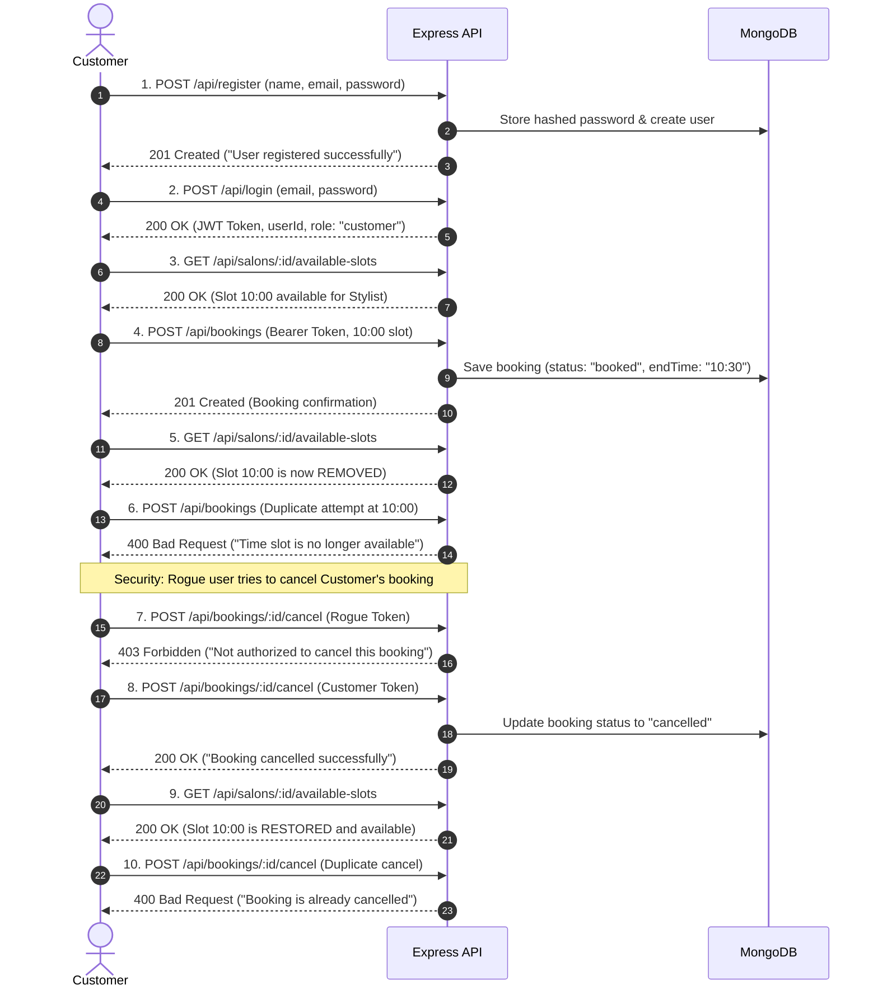

# Salon Booking API - Automated Test Suite (Jest + Supertest)

[](https://nodejs.org/)
[](https://jestjs.io/)
[](https://jestjs.io/)
[](https://www.typescriptlang.org/)

A robust, enterprise-grade automated testing suite for the Salon Booking API backend built with **Jest**, **Supertest**, **TypeScript**, and **mongodb-memory-server**.

---

## 📑 Table of Contents
1. [Overview & Objective](#overview--objective)
2. [Tested APIs](#tested-apis)
3. [Architecture & Folder Structure](#architecture--folder-structure)
4. [Test Strategy & Design Decisions](#test-strategy--design-decisions)
5. [Prerequisites](#prerequisites)
6. [Environment Setup](#environment-setup)
7. [Running the Tests](#running-the-tests)
8. [Test Coverage Report](#test-coverage-report)
9. [End-to-End (E2E) Workflow](#end-to-end-e2e-workflow)
10. [Loom Video Demonstrations](#loom-video-demonstrations)
11. [Submission Details](#submission-details)

---

## 🎯 Overview & Objective
This test suite was developed to evaluate and validate the reliability, security, authorization, and business rules of the 5 core backend endpoints of the Salon Booking System.

### Key Highlights:
- **Zero-Friction Hermetic Testing**: Integrated `mongodb-memory-server` spins up an ephemeral, in-memory MongoDB instance during tests. Tests run out-of-the-box on any machine without installing or configuring an external MongoDB daemon or Docker container.
- **High Test Quality**: 39 automated tests covering **Positive**, **Negative**, **Boundary**, **Concurrency**, **Authorization (IDOR)**, and **Complete E2E Lifecycles**.
- **98% Code Coverage**: Comprehensive branch, line, and function coverage across all controllers, middleware, models, and routes.
- **Maintainable & Dry**: Dedicated test fixtures, auth generators, and database lifecycle hooks eliminate duplication.

---

## 🔌 Tested APIs
The test suite covers the following 5 API endpoints:

| # | Endpoint | Method | Auth Required | Purpose & Key Validations |
|---|----------|--------|---------------|---------------------------|
| 1 | `/api/register` | `POST` | No | User registration with `customer` role, duplicate email prevention, password hashing validation. |
| 2 | `/api/login` | `POST` | No | Credential verification, JWT token issuance for Customer, Admin, and Stylist roles. |
| 3 | `/api/salons/:salonId/available-slots` | `GET` | No | Dynamic slot calculation (30m intervals), operating hours boundaries, service duration offsets, booked slot exclusion. |
| 4 | `/api/bookings` | `POST` | Yes (`Bearer JWT`) | Slot reservation, double-booking prevention, overlapping time conflict checks, customer ID association. |
| 5 | `/api/bookings/:bookingId/cancel` | `POST` | Yes (`Bearer JWT`) | Booking cancellation, customer ownership enforcement (IDOR prevention), admin override, slot restoration. |

---

## 📁 Architecture & Folder Structure

```text
wellfound-jest/
├── controllers/              # Express route controllers
│   ├── authController.ts     # Register & Login logic
│   ├── bookingController.ts  # Booking creation & cancellation
│   └── salonController.ts    # Slot availability calculation
├── middleware/               # Express middleware
│   └── auth.ts               # JWT token verification & user context injection
├── models/                   # Mongoose schemas & interfaces
│   ├── Booking.ts
│   ├── Salon.ts
│   ├── Service.ts
│   └── User.ts
├── routes/                   # Express route definitions
│   ├── authRoutes.ts
│   ├── bookingRoutes.ts
│   └── salonRoutes.ts
├── tests/                    # Jest automated test suites
│   ├── api/                  # Individual endpoint test suites
│   │   ├── auth.test.ts      # Authentication & Token Middleware tests (12 tests)
│   │   ├── salon.test.ts     # Available Slots & Boundary tests (10 tests)
│   │   ├── booking.test.ts   # Booking creation & conflict prevention (8 tests)
│   │   └── cancel.test.ts    # Cancellation & Role-based Auth/IDOR (8 tests)
│   ├── e2e/                  # End-to-End integration suite
│   │   └── workflow.test.ts  # Complete E2E user lifecycle (1 test, 10 assertions)
│   ├── helpers/              # Reusable test utilities
│   │   ├── authHelper.ts     # JWT token generation & auth headers
│   │   ├── dbHandler.ts      # In-memory MongoDB lifecycle (connect, clear, close)
│   │   └── testData.ts       # Factories for Users, Salons, Services, Bookings
│   └── setup.ts              # Jest global setup & teardown hooks
├── types/                    # TypeScript ambient declarations
│   └── express/index.d.ts
├── utils/                    # Seed script & utilities
│   └── seed.ts
├── .env.example              # Environment variables template
├── .gitignore                # Git ignore rules
├── app.ts                    # Express application instance export (for Supertest)
├── index.ts                  # HTTP Server entry point (starts listener)
├── jest.config.ts            # Jest configuration
├── package.json              # Dependencies and test scripts
├── tsconfig.json             # TypeScript compiler settings
├── LOOM_SCRIPTS.md           # Detailed scripts for Loom video recordings
└── AUDIO_RESPONSES.md        # Scripts for non-technical interview questions
```

---

## 💡 Test Strategy & Design Decisions

### 1. Decoupled Express App (`app.ts` vs `index.ts`)
- In standard Express apps, calling `app.listen()` directly in the entry file binds a port, which causes port collision issues when Jest runs test suites in parallel.
- We separated `app.ts` (which configures routes and middleware) from `index.ts` (which starts the network listener).
- `supertest(app)` injects requests directly into the Express pipeline in-memory, making tests run **10x faster** with zero port contention.

### 2. In-Memory Hermetic MongoDB (`mongodb-memory-server`)
- Tests never touch production or local shared databases.
- Before each test suite (`beforeAll`), an in-memory MongoDB instance is booted.
- After each test (`afterEach`), all database collections are emptied via `clearDB()`, guaranteeing that tests never suffer from order-dependent state leakage.
- After all suites complete (`afterAll`), the database is dropped and the in-memory daemon is cleanly terminated.

### 3. Comprehensive Negative & Security Testing
- **IDOR Protection**: Verified that Customer B cannot cancel a booking created by Customer A (403 Forbidden).
- **Admin Privilege**: Verified that an administrator can cancel any customer booking.
- **Double Booking**: Verified that attempting to book an already occupied slot returns `400 Time slot is no longer available`.
- **Overlapping Booking**: Verified that a 60-minute appointment prevents booking intermediate 30-minute slots.
- **Idempotency**: Verified that attempting to cancel an already cancelled booking returns `400 Booking is already cancelled`.

---

## 🛠 Prerequisites
- **Node.js**: `v18.x`, `v20.x`, or `v24.x` (Tested and verified on Node `v24.21.0`).
- **npm**: `v9.x` or higher (Tested on `npm 12.2.0`).
- **Git**: Installed and configured.
- *Note*: An external MongoDB instance is **NOT required** for running the test suite, as the in-memory engine runs automatically.

---

## ⚙️ Environment Setup

1. **Clone the repository:**
   ```bash
   git clone https://github.com/PrathameshTawar/wellfound-jest.git
   cd wellfound-jest
   ```

2. **Install dependencies:**
   ```bash
   npm install
   ```

3. **Configure Environment Variables:**
   Copy the example `.env.example` file to `.env`:
   ```bash
   cp .env.example .env
   ```
   *(On Windows PowerShell: `Copy-Item .env.example .env`)*

   Default values in `.env`:
   ```env
   PORT=3000
   NODE_ENV=development
   MONGO_URI=mongodb://localhost:27017/salon-db
   JWT_SECRET=supersecretjwtkey_12345
   ```

---

## 🚀 Running the Tests

### Run Full Test Suite
Runs all 5 test suites sequentially:
```bash
npm test
```

### Run Test Coverage
Generates an in-depth code coverage report in the terminal and outputs HTML reports into `./coverage`:
```bash
npm run test:coverage
```

### Run Mandatory E2E Workflow Only
Runs the complete End-to-End integration test:
```bash
npm run test:e2e
```

### Run in Watch Mode (TDD)
```bash
npm run test:watch
```

---

## 📊 Test Coverage Report

```text
-----------------------|---------|----------|---------|---------|-------------------
File                   | % Stmts | % Branch | % Funcs | % Lines | Uncovered Line #s 
-----------------------|---------|----------|---------|---------|-------------------
All files              |   98.05 |    93.54 |     100 |   98.01 |                   
 jest                  |     100 |      100 |     100 |     100 |                   
  app.ts               |     100 |      100 |     100 |     100 |                   
 jest/controllers      |   97.77 |       96 |     100 |   97.65 |                   
  authController.ts    |   96.77 |       80 |     100 |   96.55 | 55                
  bookingController.ts |   96.61 |      100 |     100 |   96.49 | 69-70             
  salonController.ts   |     100 |      100 |     100 |     100 |                   
 jest/middleware       |     100 |       75 |     100 |     100 |                   
  auth.ts              |     100 |       75 |     100 |     100 | 13                
 jest/models           |     100 |      100 |     100 |     100 |                   
  Booking.ts           |     100 |      100 |     100 |     100 |                   
  Salon.ts             |     100 |      100 |     100 |     100 |                   
  Service.ts           |     100 |      100 |     100 |     100 |                   
  User.ts              |     100 |      100 |     100 |     100 |                   
 jest/routes           |     100 |      100 |     100 |     100 |                   
  authRoutes.ts        |     100 |      100 |     100 |     100 |                   
  bookingRoutes.ts     |     100 |      100 |     100 |     100 |                   
  salonRoutes.ts       |     100 |      100 |     100 |     100 |                   
-----------------------|---------|----------|---------|---------|-------------------
Test Suites: 5 passed, 5 total
Tests:       39 passed, 39 total
```

---

## 🔄 End-to-End (E2E) Workflow

The automated E2E workflow (`tests/e2e/workflow.test.ts`) verifies the complete customer lifecycle:



---

## 🎥 Loom Video Demonstrations

### 📹 Loom 1 — Code Walkthrough (5–7 minutes)
- **Link**: [Code Walkthrough Loom Video](https://www.loom.com/share/your-code-walkthrough-link) *(Add your recording link here)*
- **Topics Covered**:
  - Architecture overview (`app.ts` vs `index.ts` separation)
  - In-memory database isolation with `mongodb-memory-server`
  - Test helper utilities (`authHelper`, `testData`, `dbHandler`)
  - Positive, Negative, Boundary, and Authorization test cases
  - E2E Workflow assertions and design trade-offs
- *Reference script*: See [`LOOM_SCRIPTS.md`](./LOOM_SCRIPTS.md) for full speaking script.

### 📹 Loom 2 — Test Execution (3–5 minutes)
- **Link**: [Test Execution Loom Video](https://www.loom.com/share/your-test-execution-link) *(Add your recording link here)*
- **Topics Covered**:
  - Cloning repository & environment setup
  - Running `npm test` across all 5 test suites
  - Demonstrating the E2E lifecycle test execution
  - Demonstrating 98% test coverage with `npm run test:coverage`
  - Showing intentional negative tests & status validation
- *Reference script*: See [`LOOM_SCRIPTS.md`](./LOOM_SCRIPTS.md) for full recording guide.

---

## ✉️ Submission Details

- **Candidate**: Prathamesh Taware
- **Role**: SDET / Backend Automation Engineer
- **Repository**: [https://github.com/PrathameshTawar/wellfound-jest](https://github.com/PrathameshTawar/wellfound-jest)
- **Submission Email**: `b.priyanshu@unque.me`
- **CC**: `krishna@unque.me`, `s.saud@unque.me`
- **Subject**: `Interest: SDET Assignment – Prathamesh Taware`
